# Laboratorio 3 — Sistema de búsqueda de estudiantes
### Lista vs Árbol Binario de Búsqueda (ABB) vs Árbol B+

## Codigo de Honor/Uso de herramientas de IA

Se usó un asistente de IA (Claude) para ayudar a diseñar la metodología estadística, depurar los experimentos y estructurar parte de la redacción final de este documento. Todos los datos, gráficas y conclusiones fueron generados verificados y revisados por mi en esta máquina.

---

## 1. Problema y objetivo

Se busca construir un sistema que permita buscar estudiantes por ID, insertar nuevos registros y listar todos los estudiantes en orden ascendente por ID, implementado con tres estrategias distintas:

- Lista
- Árbol Binario de Búsqueda (ABB)
- Árbol B+

El objetivo del laboratorio no es solo implementar las estructuras, sino comparar experimentalmente cómo cambia el tiempo de ejecución de cada operación a medida que crece el tamaño de entrada `N`, cómo influye el orden de inserción (IDs aleatorios o ya ordenados) y cómo varía el volumen de búsquedas `M`. Se contrasta la complejidad teórica con el comportamiento real del código, usando datos reproducibles y métricas estadísticas.

---

## 2. Estructuras implementadas

| Estructura | Buscar | Insertar | Listar (orden ascendente) |
|---|---|---|---|
| Lista | O(n) — recorrido lineal | O(1) — agrega al final | O(n log n) — ordena la lista |
| ABB | O(log n) en promedio; O(n) si degenera | O(log n) en promedio; O(n) si degenera | O(n) — recorrido in-order |
| B+ (M = 16 claves por nodo) | O(log n) con nodos internos y hojas enlazadas | O(log n) con splits | O(n) recorriendo hojas enlazadas |

### Observación clave

La implementación del ABB **no incluye rebalanceo** (AVL, Red-Black, etc.). Por eso su rendimiento depende del orden de inserción:

- si los IDs llegan aleatorios, el árbol queda razonablemente balanceado;
- si llegan ya ordenados, cada nodo cuelga a la derecha del anterior y la altura crece hasta `N` (el árbol es una cadena).

El B+ se auto-balancea: cuando un nodo se llena se parte en dos, llegue el dato que llegue, y mantiene una altura baja sin depender del orden.

---

## 3. Código principal y archivos generados

### Archivos clave del repositorio

- `analisis_escalabilidad_completo.py`: script principal del laboratorio (estructuras, experimentos, estadística, gráficas y ficha técnica). La ficha técnica nombra el script como `laboratorio3_completo.py`; es este mismo archivo.
- `README.md`: documentación del proyecto.
- `resultados_lab3/`: resultados experimentales (CSV, gráficas y ficha técnica) de la corrida final con semilla 42.


### Salidas generadas por el script

**Gráficas:** `figA_busqueda_aleatorio.png`, `figA2_busqueda_por_estructura.png`, `figA3_zoom_abb_vs_bplus.png`, `figB_busqueda_ordenado.png`, `figC_construccion_gran_escala.png`, `figD_variacion_M.png`, `figE_altura_vs_busqueda.png`, `figF_listar.png`, `figG_busqueda_M_calibrado.png`, `figH_dispersion_repeticiones.png`, `figI_estabilidad_tiempo.png`.

**CSV:** `A_busqueda_aleatorio_raw/agg.csv`, `A_altura_aleatorio.csv`, `B_busqueda_ordenado_raw/agg.csv`, `B_insercion_ordenado_agg.csv`, `B_altura_ordenado.csv`, `C_construccion_gran_escala_raw/agg.csv`, `D_variacion_M_raw/agg.csv`, `E_busqueda_M_calibrado_raw/agg.csv`, `L_listar_raw/agg.csv`, `pendientes_loglog.csv` y `ficha_tecnica.txt`. Los `_raw` contienen cada repetición (con hora de medición, duración de la ventana y número de lotes); los `_agg`, la media, desviación estándar, IC 95 %, mediana, CV y atípicos por grupo.

### Ejecutar el análisis

Requisitos: Python 3.10+, `numpy`, `pandas`, `matplotlib`.

```bash
python analisis_escalabilidad_completo.py                      # corrida completa, semilla 42 (reproduce este README)
python analisis_escalabilidad_completo.py --semilla aleatoria  # datos distintos; la semilla usada queda registrada
python analisis_escalabilidad_completo.py --semilla 123        # otra semilla concreta
python analisis_escalabilidad_completo.py --rapido             # prueba de ~20 s; Prueba 
python analisis_escalabilidad_completo.py --ventana 1.5        # ventana mínima distinta
```

Con otra semilla los resultados se guardan en `resultados_lab3_semilla_<número>/`, sin sobrescribir los de la semilla 42. La corrida completa tardó **1284 s (≈21,4 min)** en la máquina descrita abajo.

---

## 4. Metodología experimental

### 4,1 Hardware y software

El experimento corre localmente en un solo proceso, en RAM, sin disco durante las mediciones (los CSV se escriben al terminar cada experimento). La ficha técnica reporta:

- Python: 3.12.10
- SO: Windows 11
- Procesador: Intel64 Family 6 Model 186 Stepping 3, GenuineIntel
- Reloj: `time.perf_counter()` (resolución 1,0e-07 s)
- Corrida final: 10 de octubre de 2026

### 4,2 Semilla y generación de datos

Los IDs son únicos y se generan con `random.sample()` sobre un rango amplio (1.000 a 5.000.000), simulando matrículas reales. Cada estudiante tiene `id`, `nombre`, `edad` y `promedio`; solo el ID se usa para buscar y ordenar.

- **Semilla base:** 42 por defecto (reproducible); con `--semilla aleatoria` se eligen datos distintos y la semilla queda registrada en consola y en la ficha técnica.
- **Un dataset distinto por repetición:** la semilla de cada generación es `<base>-<experimento>-<N>-<repetición>`. Así la desviación estándar incluye la variación entre conjuntos de datos y no solo el ruido del reloj, y todo sigue siendo reproducible.

### 4,3 Medición de tiempos

Se usa `time.perf_counter()`.

- **Ventana mínima de 1 s:** cada medición dura **al menos 1 s**. Si un lote de búsquedas dura menos, se repite (con lotes distintos, para no medir siempre las mismas rutas) hasta acumular la ventana, y se reporta el tiempo medio por lote. Lo mismo para `listar()` (se repiten llamadas) y para la construcción del experimento C (se repiten construcciones). **Cumplimiento: 444 de 444 mediciones de búsqueda (A, B, D y E) duraron ≥ 1 s** (mínimo 1.000 s).
- **Búsqueda:** se cronometra el lote completo de `M` búsquedas sobre IDs existentes (no una individual). Antes se hace un calentamiento de hasta 200 búsquedas sin medir y se desactiva el recolector de basura (`gc`) durante la medición.
- **Inserción:** se mide construir la estructura completa con `N` elementos.
- **Listado:** se mide una llamada completa a `listar()`, verificando que los IDs salgan ordenados.

### 4,4 Orden aleatorio de ejecución

En cada repetición se baraja (con semilla) el orden de los `N` y el de las estructuras. Si el computador cambia de velocidad durante la corrida (calentamiento, procesos de fondo), ese efecto no se confunde con el efecto de `N`. La figura `figI` muestra esa posible deriva.

### 4,5 Tratamiento de valores atípicos

Dentro de cada grupo (estructura, N) con al menos 4 repeticiones se aplica la **regla del IQR**: se descartan los valores fuera de `[Q1 − 1.5·IQR, Q3 + 1.5·IQR]` antes de calcular media y desviación estándar. Se reporta además la mediana (sobre todos los datos) y cuántos valores se descartaron (`outliers_removidos`). Con menos de 4 repeticiones (experimentos B, C y E) no se aplica el filtro.

En el experimento A (7 repeticiones) se descartó 1 o 2 valores en 18 de 39 grupos (22 valores en total).

### 4,6 Estadísticas reportadas

Media, desviación estándar, **IC 95 %** de la media (t de Student, columna `*_ic95`), coeficiente de variación (`cv_pct` = desviación / media), mediana, y la **pendiente log-log** (regresión de `ln(tiempo)` contra `ln(N)`) con su `R²`, junto a las pendientes que tendrían `log₂(N+1)`, `N` y `N·log₂(N+1)` en la misma rejilla de `N` (referencia teórica). Archivo: `pendientes_loglog.csv`.

### 4,7 Experimentos realizados

| Experimento | Descripción | Parámetros |
|---|---|---|
| A | Búsqueda vs N, IDs aleatorios | N = 10, 50, 100, 200, 500, 1000, 2000, 5000, 10000, 20000, 50000, 100000, 200000; M = 10000; 7 repeticiones |
| B | Búsqueda vs N, IDs ya ordenados | N = 200, 500, 1000, 2000, 3000, 5000, 7500, 10000, 30000, 100000 (el ABB solo hasta 30000: su inserción ordenada es O(n²)); M = 10000; 3 repeticiones |
| C | Construcción a gran escala | N = 10000, 100000, 1000000; 3 repeticiones |
| D | Variación de M | N = 10000 fijo; M = 10, 100, 1000, 10000; 5 repeticiones |
| E | Búsqueda con M calibrado por estructura (para caer en 1–5 s) | N = 10000, 50000, 100000, 200000; M = 2.000.000 (ABB) y 4.000.000 (B+); 3 repeticiones |
| L | Listar vs N | N = 100, 1000, 10000, 100000; 5 repeticiones |

### 4,8 Verificación de correctitud

Antes de los experimentos se construyen las tres estructuras con `n = 2000` y se verifica que `listar()` devuelva los mismos IDs en orden ascendente y que `buscar()` encuentre un ID existente y rechace uno inexistente. Además, en cada medición de `listar()` se comprueba el orden y en cada calentamiento de búsqueda que el ID exista. Salida esperada:

```text
[OK] Verificacion de correctitud (n=2000): listar() y buscar() coinciden en Lista, ABB y B+.
```

---

## 5. Resultados

Todos los tiempos están en **segundos**. Las tablas salen directamente de los CSV de `resultados_lab3/`. En los experimentos A y B, el tiempo es el de un lote de `M = 10.000` búsquedas.

### 5,1 Altura del árbol vs N

**IDs aleatorios** (media de 7 repeticiones):

| N | Altura ABB | Altura B+ |
|---:|---:|---:|
| 10 | 5,6 | 1,0 |
| 50 | 10,9 | 2,0 |
| 100 | 13,9 | 2,0 |
| 200 | 15,4 | 3,0 |
| 500 | 18,4 | 3,0 |
| 1.000 | 23,3 | 3,0 |
| 2.000 | 24,7 | 4,0 |
| 5.000 | 28,6 | 4,0 |
| 10.000 | 31,4 | 4,0 |
| 20.000 | 35,0 | 4,9 |
| 50.000 | 36,7 | 5,0 |
| 100.000 | 41,4 | 5,0 |
| 200.000 | 44,6 | 6,0 |

**IDs ya ordenados** (3 repeticiones):

| N | Altura ABB | Altura B+ |
|---:|---:|---:|
| 200 | 200 | 3 |
| 500 | 500 | 3 |
| 1.000 | 1.000 | 4 |
| 2.000 | 2.000 | 4 |
| 3.000 | 3.000 | 4 |
| 5.000 | 5.000 | 4 |
| 7.500 | 7.500 | 5 |
| 10.000 | 10.000 | 5 |
| 30.000 | 30.000 | 5 |
| 100.000 | — | 6 |

- Con IDs ordenados el ABB se degenera por completo: **su altura es exactamente `N`** (hasta N = 30.000, que es donde se mide). El B+ solo pasa de 3 a 6 niveles.
- Con IDs aleatorios la altura del ABB crece despacio (5,6 → 44,6) y la del B+ de 1 a 6.


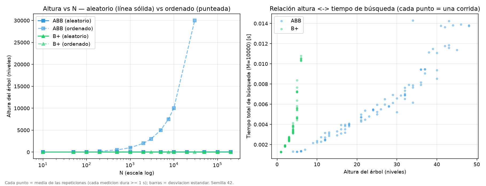

La altura es el número de niveles que hay que recorrer en el peor caso, pero no es proporcional al tiempo: un nivel del B+ busca entre hasta 15 claves y cuesta más que un nivel del ABB. Con N = 200.000, el ABB tiene 7,4 veces más niveles que el B+ y solo es 1,32 veces más lento.

---

### 5,2 Búsqueda vs N (IDs aleatorios) — experimento A

| N | Lista [s] | ABB [s] | B+ [s] | Lista / ABB | Lista / B+ | ABB / B+ |
|---:|---:|---:|---:|---:|---:|---:|
| 10 | 0,00167 | 0,00133 | 0,00128 | 1,26 | 1,31 | 1,04 |
| 50 | 0,00589 | 0,00234 | 0,00183 | 2,51 | 3,21 | 1,28 |
| 100 | 0,0112 | 0,00294 | 0,00192 | 3,79 | 5,82 | 1,54 |
| 200 | 0,0231 | 0,00349 | 0,0024 | 6,61 | 9,59 | 1,45 |
| 500 | 0,061 | 0,0041 | 0,00253 | 14,9 | 24,2 | 1,62 |
| 1.000 | 0,122 | 0,00484 | 0,00269 | 25,2 | 45,2 | 1,80 |
| 2.000 | 0,238 | 0,00542 | 0,00319 | 43,9 | 74,5 | 1,70 |
| 5.000 | 0,597 | 0,00616 | 0,00344 | 97,0 | 174 | 1,79 |
| 10.000 | 1,21 | 0,00692 | 0,00381 | 175 | 318 | 1,82 |
| 20.000 | 2,38 | 0,00787 | 0,00462 | 303 | 516 | 1,70 |
| 50.000 | 6,44 | 0,00944 | 0,00558 | 682 | 1.154 | 1,69 |
| 100.000 | 13,2 | 0,0115 | 0,00731 | 1.151 | 1.806 | 1,57 |
| 200.000 | 28 | 0,0138 | 0,0105 | 2.033 | 2.677 | 1,32 |

Ruido relativo (CV = desviación estándar / media, %):

| Estructura | CV mediano | CV máximo |
|---|---:|---:|
| Lista | 1,54 | 3,40 |
| ABB | 2,50 | 7,91 |
| B+ | 2,00 | 2,68 |

El CV máximo (7,9 %) es del ABB con N = 200; para N ≥ 10.000 ninguna estructura supera el 3,4 %.

Pendiente log-log (tiempo vs N):

| Estructura | Pendiente | R² | Referencia |
|---|---:|---:|---|
| Lista | 0,999 | 0,999 | N → 1 |
| ABB | 0,213 | 0,982 | log₂N → 0,151 |
| B+ | 0,186 | 0,957 | log₂N → 0,151 |

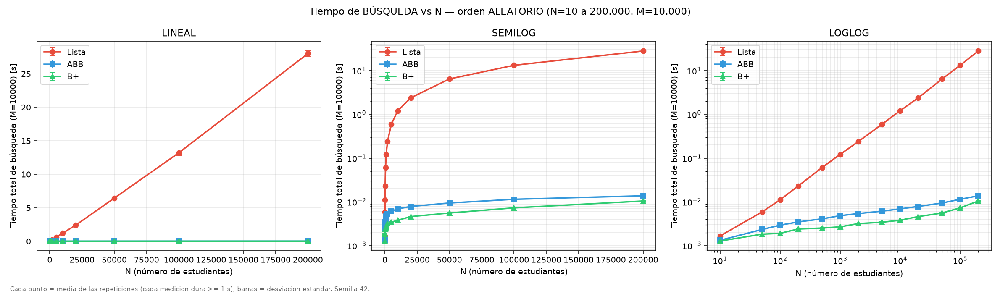

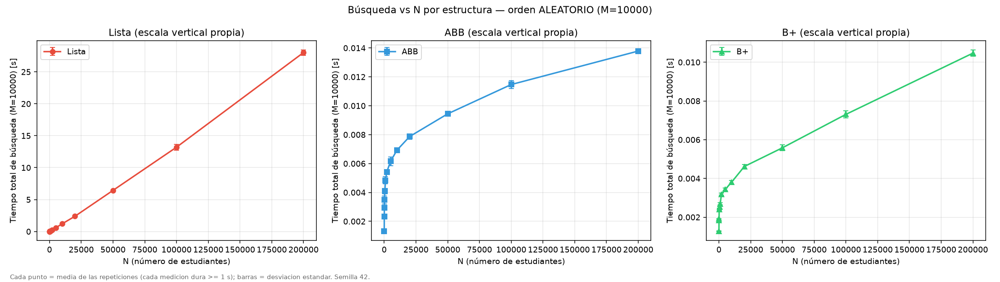

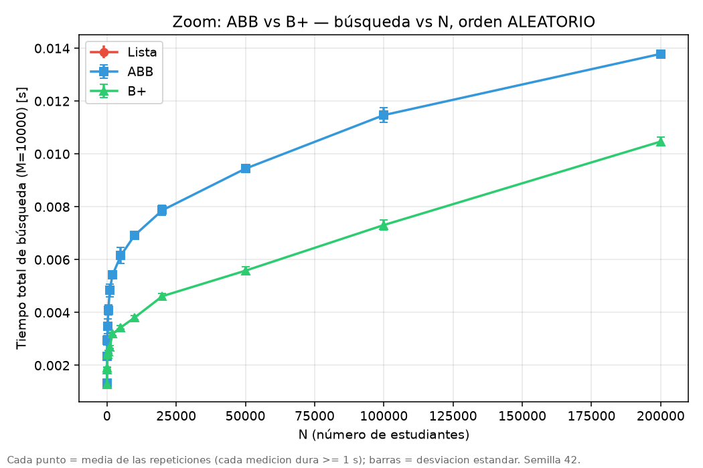

**Lectura:**

- Con N = 200.000 la Lista tarda **28 s**, el ABB 0,0138 s y el B+ 0,0105 s: la Lista es unas **2.033 veces** más lenta que el ABB y **2.677 veces** más lenta que el B+.
- La pendiente de la Lista (0,999) es compatible con O(n). Las de los árboles (0,213 y 0,186) son sublineales y algo mayores que la referencia ideal de `log₂N` (0,151); que sean bajas muestra un crecimiento mucho más lento que el lineal, pero **no prueba por sí sola** O(log n).
- Para N pequeño la diferencia es mínima porque domina el costo fijo de Python (N = 10: Lista 0,00167 s, ABB 0,00133 s, B+ 0,00128 s); la separación crece con N.
- **ABB contra B+:** el B+ es más rápido en todos los N medidos, pero la diferencia es modesta: entre 1,04 y 1,82 veces (máxima con N = 10.000; con N = 200.000 es 1,32). Con datos aleatorios ambos son buenos; la diferencia grande aparece con IDs ordenados.
- Con M = 10.000 solo la Lista cae en el rango de 1 a 5 s recomendado (N = 10.000 y 20.000). El ABB y el B+ miden menos de 0,02 s por lote; por eso se hizo el experimento E (sección 5,6).

---

### 5,3 Búsqueda vs N (IDs ya ordenados) — experimento B

| N | Lista [s] | ABB [s] | B+ [s] |
|---:|---:|---:|---:|
| 200 | 0,0193 | 0,0304 | 0,00236 |
| 500 | 0,0481 | 0,0748 | 0,00245 |
| 1.000 | 0,0964 | 0,151 | 0,003 |
| 2.000 | 0,198 | 0,3 | 0,0032 |
| 3.000 | 0,308 | 0,461 | 0,00325 |
| 5.000 | 0,583 | 0,797 | 0,00345 |
| 7.500 | 0,986 | 1,17 | 0,00399 |
| 10.000 | 1,41 | 1,59 | 0,00424 |
| 30.000 | 5,61 | 5,04 | 0,00482 |
| 100.000 | 62,8 | — | 0,00747 |

Pendiente log-log: Lista 1,256 (R² 0,982), ABB 1,020 (R² 1,000), B+ 0,177 (R² 0,949).

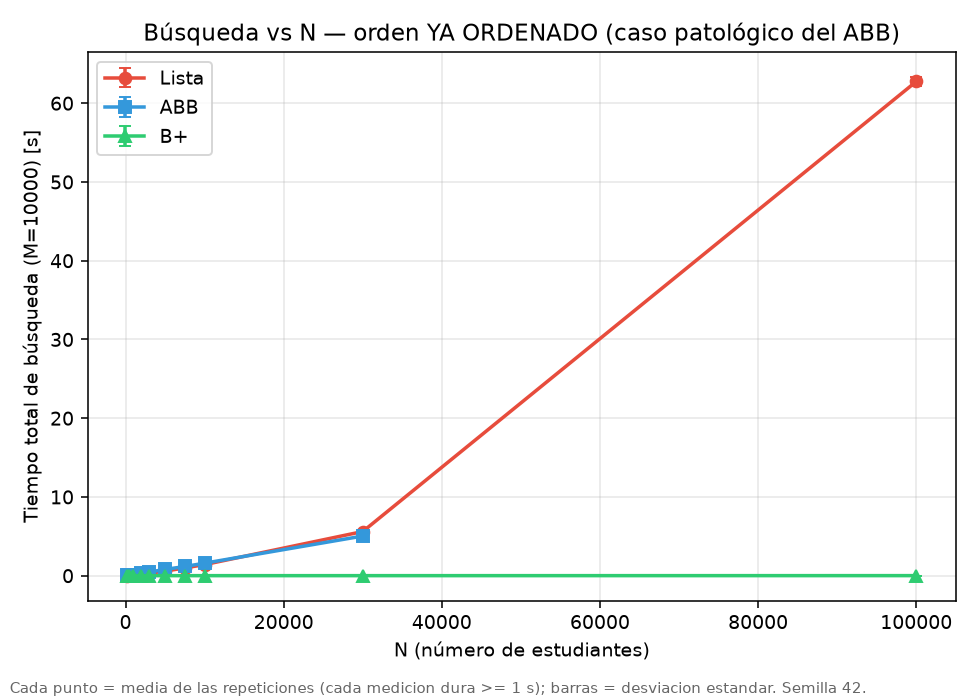

**Lectura:**

- El ABB con IDs ordenados es una cadena de altura `N`: su pendiente (1,020) es la de una búsqueda lineal. Con N = 10.000 tarda **1,59 s** frente a 0,00692 s con IDs aleatorios: **229 veces más**.
- El B+ casi no cambia: con N = 10.000 tarda 0,00424 s. Con N = 100.000 sigue en 0,00747 s mientras la Lista tarda 62,8 s.
- **El ABB ordenado y la Lista están en el mismo orden de magnitud y no hay un ganador fijo:** con N ≤ 10.000 el ABB es algo más lento (N = 10.000: ABB 1,59 s, Lista 1,41 s), pero con N = 30.000 es algo más rápido (ABB 5,04 s, Lista 5,61 s). La diferencia entre ambos es pequeña frente a la que los separa del B+.
- **Hallazgo sobre la Lista:** con N = 100.000 la Lista con IDs ordenados tarda 62,8 s, **4,75 veces más** que con IDs aleatorios (13,2 s), aunque el algoritmo es el mismo (recorrido lineal). Una hipótesis probable es el **efecto de la memoria caché**: al ordenar la lista, el recorrido salta entre objetos que fueron creados en otro orden y están dispersos en memoria, mientras que con datos aleatorios se recorren objetos contiguos. Esto es una hipótesis, **no se midió directamente en este laboratorio**; explica por qué la pendiente de la Lista aquí (1,256) es mayor que 1.

---

### 5,4 Construcción (insertar N elementos)

**IDs ya ordenados** (parte del experimento B, 3 repeticiones):

| N | Lista [s] | ABB [s] | B+ [s] |
|---:|---:|---:|---:|
| 200 | 3,40e-05 | 0,0006 | 0,000105 |
| 500 | 3,63e-05 | 0,00394 | 0,000255 |
| 1.000 | 9,29e-05 | 0,0156 | 0,000537 |
| 2.000 | 0,000125 | 0,059 | 0,00117 |
| 3.000 | 0,000189 | 0,13 | 0,00198 |
| 5.000 | 0,000267 | 0,36 | 0,00326 |
| 7.500 | 0,000393 | 0,785 | 0,00519 |
| 10.000 | 0,000476 | 1,53 | 0,0109 |
| 30.000 | 0,00179 | 14,1 | 0,0244 |
| 100.000 | 0,00717 | — | 0,119 |

Pendiente log-log: ABB **1,995** (R² 1,000), B+ 1,141, Lista 0,877. La pendiente ≈ 2 del ABB confirma que insertar N IDs ordenados es O(n²): con N = 30.000 tarda 14,1 s, frente a 0,0244 s del B+. (La pendiente de la Lista por debajo de 1 refleja costos fijos con N pequeños.)

**IDs aleatorios, gran escala** (experimento C, 3 repeticiones):

| N | Lista [s] | ABB [s] | B+ [s] | ABB / Lista | B+ / Lista |
|---:|---:|---:|---:|---:|---:|
| 10.000 | 0,000356 | 0,00776 | 0,00676 | 21,8 | 19,0 |
| 100.000 | 0,00389 | 0,117 | 0,098 | 30,0 | 25,2 |
| 1.000.000 | 0,0461 | 1,95 | 1,94 | 42,3 | 42,1 |

Pendiente log-log: Lista 1,056, ABB 1,200, B+ 1,229 (solo 3 puntos por estructura). Con N = 1.000.000, construir un árbol cuesta unas **42,3 veces** (ABB) y **42,1 veces** (B+) lo que cuesta llenar una Lista. ABB y B+ quedan prácticamente empatados (1,95 s y 1,94 s); no se afirma cuál es más rápido al construir. El CV más alto es 9,6 % (ABB, N = 100.000).

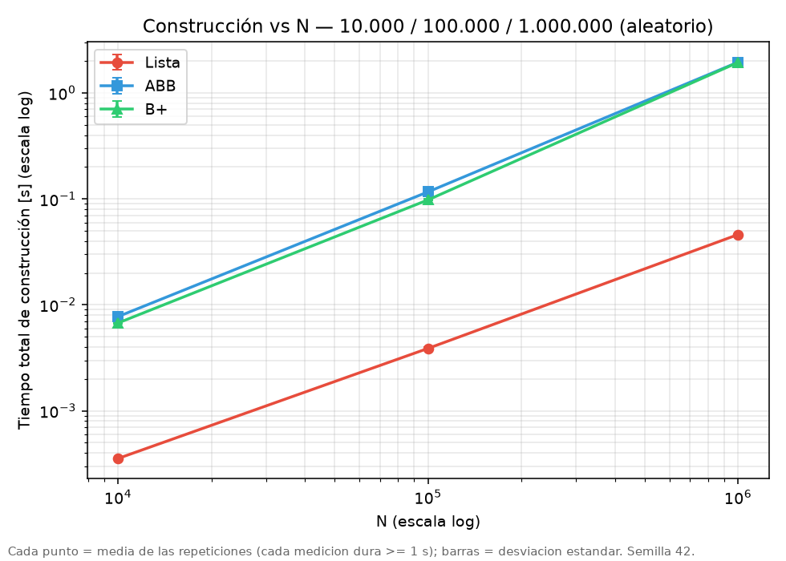

---

### 5,5 Variación del número de búsquedas M (N = 10.000)

| M | Lista [s] | ABB [s] | B+ [s] |
|---:|---:|---:|---:|
| 10 | 0,00116 | 6,92e-06 | 3,33e-06 |
| 100 | 0,0119 | 6,99e-05 | 3,63e-05 |
| 1.000 | 0,121 | 0,000695 | 0,000376 |
| 10.000 | 1,25 | 0,00696 | 0,00374 |

Pendiente log-log (tiempo vs M): Lista 1,010, ABB 1,001, B+ 1,016 (R² = 1,000). El tiempo crece de forma **lineal en M**, como se espera de búsquedas independientes; lo que distingue a las estructuras es el costo por búsqueda (la altura de cada recta). Con la ventana mínima de 1 s, el costo fijo de preparar cada medición ya no distorsiona los valores pequeños de M.

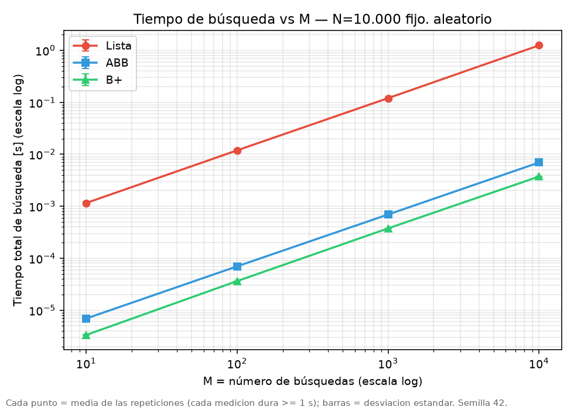

---

### 5,6 Búsqueda con M calibrado por estructura — experimento E

Como el ABB y el B+ son entre cientos y miles de veces más rápidos que la Lista, con un M común miden menos de 1 s. Aquí cada estructura usa su propio M (ABB: 2.000.000; B+: 4.000.000) para caer en el rango de 1 a 5 s. **Estas curvas no se comparan entre sí** (M distinto); la comparación entre estructuras es la del experimento A. La Lista se toma del experimento A (M = 10.000).

| N | ABB, M = 2.000.000 [s] | B+, M = 4.000.000 [s] | Lista, M = 10.000 [s] |
|---:|---:|---:|---:|
| 10.000 | 1,41 | 1,58 | 1,21 |
| 50.000 | 1,87 | 2,26 | 6,44 |
| 100.000 | 2,31 | 2,91 | 13,2 |
| 200.000 | 2,85 | 4,31 | 28 |

ABB: 1,41 a 2,85 s; B+: 1,58 a 4,31 s; ambos dentro del rango de 1 a 5 s. CV máximo: ABB 3,8 %, B+ 9,0 %.

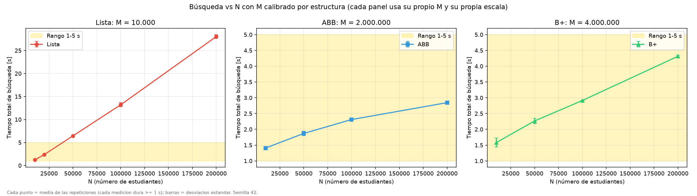

---

### 5,7 Listar en orden ascendente vs N

| N | Lista [s] | ABB [s] | B+ [s] | Lista / B+ | ABB / B+ |
|---:|---:|---:|---:|---:|---:|
| 100 | 5,14e-06 | 7,75e-06 | 7,23e-07 | 7,12 | 10,7 |
| 1.000 | 9,13e-05 | 7,87e-05 | 6,46e-06 | 14,1 | 12,2 |
| 10.000 | 0,00136 | 0,000807 | 5,68e-05 | 23,9 | 14,2 |
| 100.000 | 0,0212 | 0,0161 | 0,0023 | 9,18 | 7,00 |

Pendiente log-log: Lista 1,202, ABB 1,097, B+ 1,145. El B+ es el más rápido en todos los N: sus hojas ya están ordenadas y enlazadas, así que solo las recorre. Con N = 100.000: Lista 0,0212 s, ABB 0,0161 s, B+ 0,0023 s (B+ unas 9,18 veces más rápido que la Lista). Lista y ABB quedan cerca entre sí. El CV llega hasta 8,4 % en algún punto, así que se interpretan las tendencias, no los factores exactos.

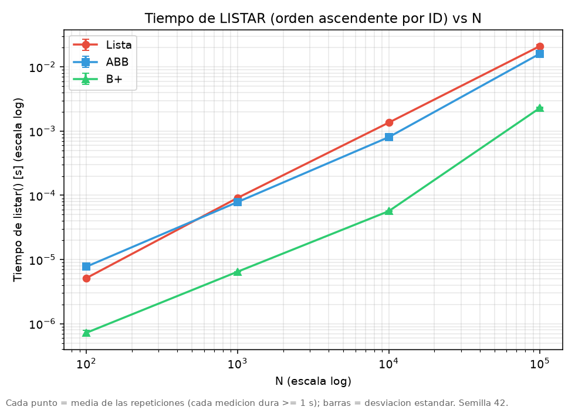

---

### 5,8 Dispersión entre repeticiones y estabilidad del computador

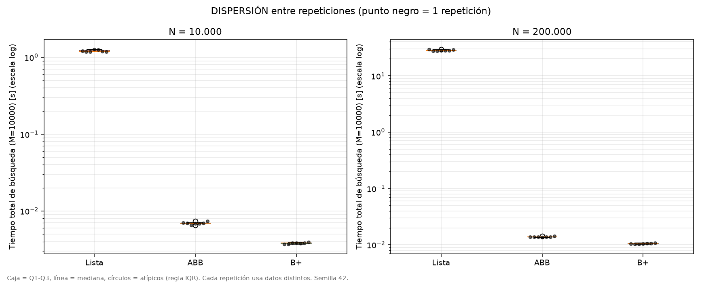

`figH` muestra las 7 repeticiones del experimento A en N = 10.000 y N = 200.000 (caja = Q1–Q3, línea = mediana, círculos = atípicos por IQR). Las cajas son angostas: las repeticiones, cada una con datos distintos, dan tiempos muy parecidos.

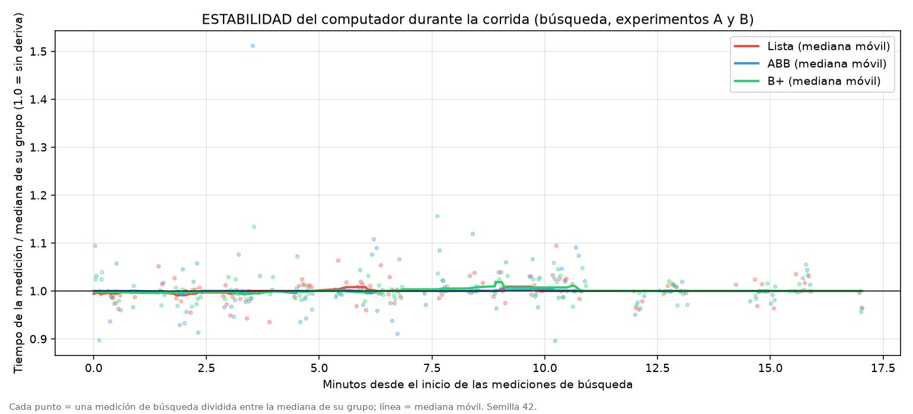

`figI` divide cada medición de búsqueda (experimentos A y B) entre la mediana de su grupo y la grafica contra el tiempo de corrida (≈ 17 min de mediciones de búsqueda). Si el computador se hubiera ralentizado, la línea se alejaría de 1,0. Aquí el 90 % de las mediciones queda entre 0,96 y 1,06 de su mediana, solo el 0,3 % supera 1,2 y el máximo es 1,51: **no hubo deriva apreciable**.

---

## 6. Interpretación frente a la teoría

### 6,1 Lista

- Búsqueda lineal: pendiente 0,999 en el experimento A, coherente con O(n).
- Construcción muy barata (pendiente 1,056, ≈ O(n)): 0,0461 s con N = 1.000.000.
- Listar exige ordenar (O(n log n)): su pendiente es la mayor de las tres estructuras al listar.
- Con datos grandes e IDs ordenados, el costo de la búsqueda puede subir mucho más allá de lo que predice el algoritmo por efectos de memoria (sección 5,3).

### 6,2 ABB

- Con IDs aleatorios: altura 5,6 → 44,6 y pendiente 0,213: crecimiento sublineal, consistente con una altura cercana a logarítmica.
- Con IDs ordenados: altura = N, búsqueda con pendiente 1,020 (O(n)) e inserción con pendiente 1,995 (O(n²)). Sin rebalanceo, el ABB no es seguro frente al peor caso.

### 6,3 B+

- Altura de 1 a 6 niveles con aleatorios y de 3 a 6 con ordenados: insensible al orden de entrada.
- Búsqueda estable (pendiente 0,186 con aleatorios, 0,177 con ordenados) y el listado más rápido por recorrer hojas enlazadas.
- Su costo: construir es unas decenas de veces más caro que llenar una Lista.

---

## 7. Hallazgos principales

1. **La Lista escala linealmente** (pendiente 0,999): con N = 200.000 es unas 2.033 veces más lenta que el ABB y 2.677 veces más que el B+ en búsqueda aleatoria.
2. **El ABB sin rebalanceo depende del orden de inserción:** con IDs ordenados su altura es `N` y la búsqueda con N = 10.000 pasa de 0,00692 s a 1,59 s (229 veces).
3. **El B+ es casi insensible al orden:** con N = 10.000 tarda 0,00381 s con aleatorios y 0,00424 s con ordenados.
4. **Con datos aleatorios ABB y B+ son parecidos** (el B+ entre 1,04 y 1,82 veces más rápido); la ventaja grande del B+ aparece con IDs ordenados y al listar.
5. **Los árboles cuestan más de construir:** con N = 1.000.000, ≈ 42,3 veces (ABB) y 42,1 veces (B+) la Lista; el costo se compensa con muchas búsquedas.
6. **Listar:** el B+ es el más rápido; con N = 100.000 unas 9,18 veces más que la Lista.
7. **El tiempo es lineal en M** (pendientes ≈ 1,00); lo que cambia entre estructuras es el costo por búsqueda.

---

## 8. Limitaciones y honestidad de los resultados

- **Una sola máquina y una sola semilla base (42).** Cada repetición usa datos distintos, pero los segundos exactos dependen del hardware; lo robusto son las tendencias y los órdenes de magnitud. El script permite repetir con otra semilla (`--semilla aleatoria`).
- **Ruido residual:** CV mediano ≈ 2 %, con máximos de 7,9 % (ABB, experimento A), 9,6 % (ABB, construcción N = 100.000) y 9,0 % (B+, experimento E). Los experimentos B, C y E tienen solo 3 repeticiones, por lo que no se aplica IQR y los IC 95 % son más anchos.
- **ABB contra B+ en búsqueda aleatoria:** la diferencia es modesta (hasta ≈ 1,8 veces) y puede variar con el hardware.
- **Las pendientes log-log son aproximaciones:** que una pendiente sea baja muestra comportamiento sublineal, no demuestra O(log n). En el experimento C solo hay 3 puntos por estructura.
- **No se midió memoria.** El ABB no se rebalancea a propósito (es parte del objetivo del laboratorio).

---

## 9. Conclusión

La complejidad teórica se refleja en el comportamiento práctico, y la estructura de datos importa tanto como el algoritmo:

- La Lista es útil con pocos datos o pocas búsquedas, y la más barata de construir.
- El ABB funciona bien solo si el orden de inserción es razonablemente aleatorio; con IDs ordenados se degenera hasta comportarse como una lista (o peor al insertar).
- El B+ es la opción más robusta: búsqueda estable sin importar el orden y listado ordenado muy eficiente.

La implementación quedó verificada en correctitud y en escalabilidad, con un protocolo de medición documentado (ventana mínima de 1 s, repeticiones con datos distintos, orden de ejecución aleatorio, IC 95 %, atípicos por IQR y comprobación de estabilidad).

---